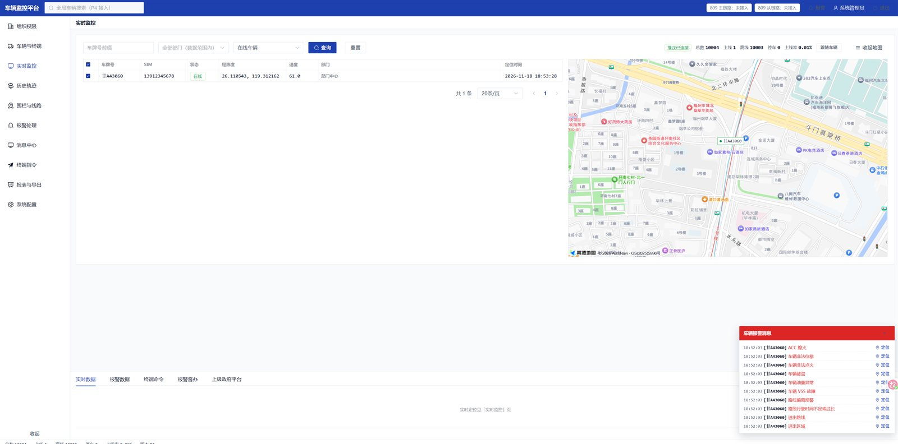

# car-monitoring

## 📋 目录

- [项目简介](#项目简介)
- [技术栈](#技术栈)
- [项目结构](#项目结构)
- [环境要求](#环境要求)
- [快速开始](#快速开始)
- [配置说明](#配置说明)
- [部署指南](#部署指南)
- [API 文档](#api-文档)
- [常见问题](#常见问题)

## 项目简介

本工程是车辆监控平台：四个可独立启动的后端部署单元（808 网关、809 企业侧、809 监管侧、管理端 API）加一个 Vue 3 管理端，覆盖终端接入、定位与轨迹、围栏与线路、报表导出、报警处理、终端指令与上级平台互通。



## 技术栈

| 分类 | 技术 | 版本 |
| --- | --- | --- |
| JDK | Oracle JDK（`release=17`） | 17.0.11 |
| 构建 | Maven / Node.js / npm | 3.9.8 / 22.22.2 / 10.9.7 |
| 后端框架 | Spring Boot / Spring Framework | 4.1.2 / 7.0.10 |
| ORM | MyBatis-Plus（Boot 4 starter） | 3.5.18 |
| 结构管理 | 版本化 SQL 脚本（`docs/db/migration`，人工执行） | V1～V11 |
| 关系库 | MySQL 8 / mysql-connector-j | 8.0（容器 `mysql-8.0`） / 9.7.0 |
| TCP | Netty（由 Boot BOM 管理） | 4.2.19.Final |
| 消息 | Spring AMQP / amqp-client | Boot 4.1.2 BOM / 5.31.0 |
| 缓存与会话 | Spring Data Redis / Spring Session | 容器 `redis-6.2.6` |
| 轨迹库 | MongoDB | 6.0.13（容器 `mongodb-6.2.6`） |
| API 文档 | Knife4j Boot4 starter / springdoc | 5.8.2 / 3.0.3 |
| JSON | Jackson 2 / 3（按 Knife4j 安全基线） | 2.22.4 / 3.1.8 |
| 前端 | Vue / Vue Router / Pinia | 3.5.45 / 4.6.5 / 2.3.1 |
| 前端构建 | Vite / TypeScript / Sass | 6.4.6 / 5.8.3 / 1.108.2 |
| UI 与图表 | Element Plus / ECharts | 2.14.8 / 5.6.0 |
| 监控 | Micrometer Prometheus | 由 Boot 4.1.2 BOM 管理 |

## 项目结构

```text
car-monitoring/
├── pom.xml                        # 父 pom：JDK 17、BOM、依赖版本唯一声明处、Enforcer 门禁
├── cm-protocol/                   # JT808/JT809 编解码边界，纯 Java，禁 Spring/Netty/DB/MQ
├── cm-domain/                     # 领域规则，含 PositionVersion 乱序判定
├── cm-infrastructure/             # MyBatis-Plus、MySQL、Redis、RabbitMQ、MongoDB、指标
├── cm-transport-netty/            # Netty 依赖与 ChannelRoute 连接 fencing
├── cm-gateway-808/                # 终端接入部署单元，管理端口 18081
├── cm-integration-809/            # 企业侧 JT809 部署单元，管理端口 18082
├── cm-gov-809/                    # 监管侧 JT809 部署单元，管理端口 18083
├── cm-admin-api/                  # 管理端 REST API，端口 8081
├── cm-admin-web/                  # Vue 3 管理端，Vite dev 端口 5173
├── deploy/                        # 建库脚本、RabbitMQ 初始化、隔离端口 compose 模板、Nginx 配置
│   └── p2/                        # P2 对照数据装载、新旧成对查询、schema 前置检查
├── scripts/                       # 依赖收敛检查、一键验证、本地启动、P2 逐行对照
├── docs/                          # 阶段报告、进度台账与数据库迁移脚本
│   ├── db/migration/              # 版本化结构脚本 V1～V11，人工按序执行，不随 JAR 发布
│   └── legacy-baseline/           # 旧系统迁移计划与实测基线（只读快照）
├── .github/workflows/ci.yml       # 后端与前端的 CI 门禁
└── .vscode/                       # UTF-8、JDK 17 编译 / JDK 25 语言服务器、调试配置
```

## 环境要求

- JDK 17（`JAVA_HOME` 指向 17.0.11），Maven 3.9.8，Node.js 22.22.2，npm 10.9.7。
- 本机常驻容器：`mysql-8.0`（3306，`root/123456`）、`redis-6.2.6`（6379，无密码）、`rabbitmq`（5672 / 15672）、`mongodb-6.2.6`（27017，bitnami MongoDB 6.0.13）。
- Windows 上执行 `.ps1` 用 `powershell -NoProfile -File`，脚本已带 UTF-8 BOM。

## 快速开始

### 后端启动

```text
http://127.0.0.1:18081/actuator/health   cm-gateway-808
http://127.0.0.1:18082/actuator/health   cm-integration-809
http://127.0.0.1:18083/actuator/health   cm-gov-809
http://127.0.0.1:8081/actuator/health    cm-admin-api
http://127.0.0.1:8081/api/v1/system/info 骨架探针
```

### 前端启动

```powershell
cd cm-admin-web
npm install
npm run dev
```

访问 `http://127.0.0.1:5173`。Vite 把 `/api` 与 `/ws` 代理到 `http://127.0.0.1:8081`，因此不用配置跨域。生产构建产物在 `cm-admin-web/dist/`，最小宽度 1280px。

## 配置说明

| 配置项 | 说明 | 默认值 |
| --- | --- | --- |
| `CM_DB_URL` | MySQL JDBC URL | `jdbc:mysql://127.0.0.1:3306/car_monitoring?...` |
| `CM_DB_USERNAME` / `CM_DB_PASSWORD` | 新库账号；dev Profile 在 `application-dev.yml` 内置本地口令，生产由环境变量注入 | `cm_app` / `CmApp@2026` |
| `CM_REDIS_HOST` / `CM_REDIS_PORT` / `CM_REDIS_DATABASE` | Redis 连接 | `127.0.0.1` / `6379` / `0` |
| `CM_MQ_HOST` / `CM_MQ_PORT` / `CM_MQ_VHOST` | RabbitMQ 连接，vhost 由 `init-rabbitmq.sh` 创建 | `127.0.0.1` / `5672` / `cm` |
| `CM_MONGO_URI` | 轨迹库连接，P3 接入时间序列集合 | `mongodb://127.0.0.1:27017/car_monitoring_telemetry` |
| `CM_SESSION_STORE` | Spring Session 存储类型 | `redis` |
| `CM_ADMIN_API_PORT` | 管理端 API 端口 | `8081` |
| `CM_GATEWAY_808_HTTP_PORT` 等 | 三个网关进程的管理端口 | `18081` / `18082` / `18083` |
| `CM_ID_WORKER_ID` / `CM_ID_DATACENTER_ID` | 雪花 ID 实例标识，多实例必须唯一（0~31） | `0` / `0` |
| `CM_DOC_PRODUCTION` | 是否屏蔽在线文档 | `false` |
| `SPRING_PROFILES_ACTIVE` | dev / prod Profile | `dev` |
| `CM_P2_DB_TEST` | 是否启用真实 MySQL 事务回滚集成测试；未设置时该测试跳过 | 未设置 |
| `CM_P3_DB_TEST` | 是否启用 P3 真库用例（租约并发、ack 状态机、死信重放） | 未设置 |
| `CM_P3_REDIS_TEST` | 是否启用 P3 真 Redis 用例（在线租约、最新位置、去重集合、里程归集） | 未设置 |
| `CM_P3_MQ_TEST` | 是否启用真实 broker 用例（confirm / mandatory return / 不可达） | 未设置 |
| `CM_P4_DB_TEST` | 是否启用 P4 真库与 HTTP 链路用例 | 未设置 |
| `CM_MAP_KEY` / `CM_MAP_SECURITY_CODE` | 高德地图 JS API 凭据，只走环境变量；缺 key 时围栏页提示地图不可用，区域列表仍可维护 | 空 |
| `CM_P2_DB_URL` / `CM_P2_DB_USERNAME` / `CM_P2_DB_PASSWORD` | 集成测试连接参数，只在 `CM_P2_DB_TEST=true` 时读取 | 本地开发库 / `cm_app` / 本地口令 |
| `CM_P2_ROOT_PASSWORD` | 对照脚本连接 MySQL 容器用的 root 口令，通过 `docker exec -e MYSQL_PWD` 传入 | 本地开发口令 |

把 `application*.yml` 放到 `car-monitoring/config/` 即可覆盖 JAR 内配置：`start-local.ps1` 已带 `--spring.config.additional-location=optional:file:./config/`。`deploy/.env.example` 是目标环境 compose 模板的变量样例，`deploy/.env` 不入库。

开发 Profile 的数据库与 RabbitMQ 口令写在各模块 `application-dev.yml`，IDE 直接启动或 `java -jar` 都不需要再注入环境变量；生产 Profile 仍走环境变量，缺凭据即启动失败。该口令与 `deploy/init-mysql.sql`、`deploy/init-rabbitmq.sh`、`deploy/.env.example` 是同一个值，修改时必须同步。

## 部署指南

```powershell
mvn -B -ntp clean package
```

四个可执行 JAR 分别是各模块 `target/` 下的 `cm-gateway-808.jar`、`cm-integration-809.jar`、`cm-gov-809.jar`、`cm-admin-api.jar`（`finalName` 已去掉版本号）。

## 常见问题

**Q: `cm-admin-api` 启动报 `ClassNotFoundException: org.springframework.boot.autoconfigure.web.servlet.WebMvcProperties`？**

A: 引入了 Boot 3.x 专用的 `knife4j-openapi3-jakarta-spring-boot-starter`（内置 springdoc 2.9.1）。Boot 4.1 必须用 `com.baizhukui:knife4j-openapi3-boot4-spring-boot-starter:5.8.2`（内置 springdoc 3.0.3），父 pom 已锁定该坐标。

**Q: `start-local.ps1` 报端口已被占用？**

A: 脚本会打印 `OwningProcess`，按 PID 停止本轮启动的进程即可，不要按映像名批量杀 `java.exe`——VSCode 的 Java 语言服务器也是 Java 进程。

**Q: PowerShell 脚本里中文报错或字符串解析失败？**

A: 三个 `.ps1` 已写为 UTF-8 BOM，用 `powershell -NoProfile -File <脚本>` 执行；`check-dependency-convergence.ps1` 另用 `System.Text.UTF8Encoding` 显式读取子模块 pom，避免 Windows PowerShell 5.1 按 GBK 解码中文描述。

**Q: `mvn test` 没有跑测试？**

A: 根 pom 设了 `maven.test.skip=true`（打包提速）。显式跑测试用 `mvn -B -ntp test "-Dmaven.test.skip=false"`，一键脚本已经包含这一步。

**Q: 依赖上界检查为什么有豁免？**

A: Jackson 2 / 3 与 `amqp-client` 已按 Knife4j 官方基线用属性覆盖收敛，不豁免。只剩 `commons-lang3` 与 `commons-logging` 两处由 Boot 4.1.2 BOM 统一管理的第三方声明差异，在 `dependency-convergence` profile 里显式豁免并在父 pom 写明复核条件。逐条处置见 `docs/p1-skeleton-report.md` 第 8 节。

**Q: P2 为什么没用 MyBatis-Plus 的分页插件，`IService` 的包名也和常见写法不一样？**

A: 3.5.18 把 `IService` / `ServiceImpl` 移到 `mybatis-plus-spring` 模块的 `com.baomidou.mybatisplus.spring.service` 包，并把 `PaginationInnerInterceptor` 拆到 `mybatis-plus-jsqlparser` 模块。本机仓库没有与 3.5.18 匹配的 jsqlparser 构件，因此 P2 用显式 `LIMIT #{offset}, #{size}` 加独立 `COUNT(*)` 查询分页，不引入版本不确定的依赖。分页结果仍用 MyBatis-Plus 的 `IPage` 承载，P3/P4 若补齐该模块可以再切换。

**Q: `verify-p2-parity.ps1` 报 Schema precheck failed？**

A: 前置检查核对三件事：20 张业务表齐备、`cm_operation_log.ip` 已放宽到 512、`cm_dict_item` 的 `uk_dict_type_code` 已按 V4 换成 `idx_dict_type_code`，三项全中才返回 3。缺项说明 `docs/db/migration` 的 V1～V4 没按顺序执行完。旧库 `gps` 必须完整；脚本不会替你重建旧库。
